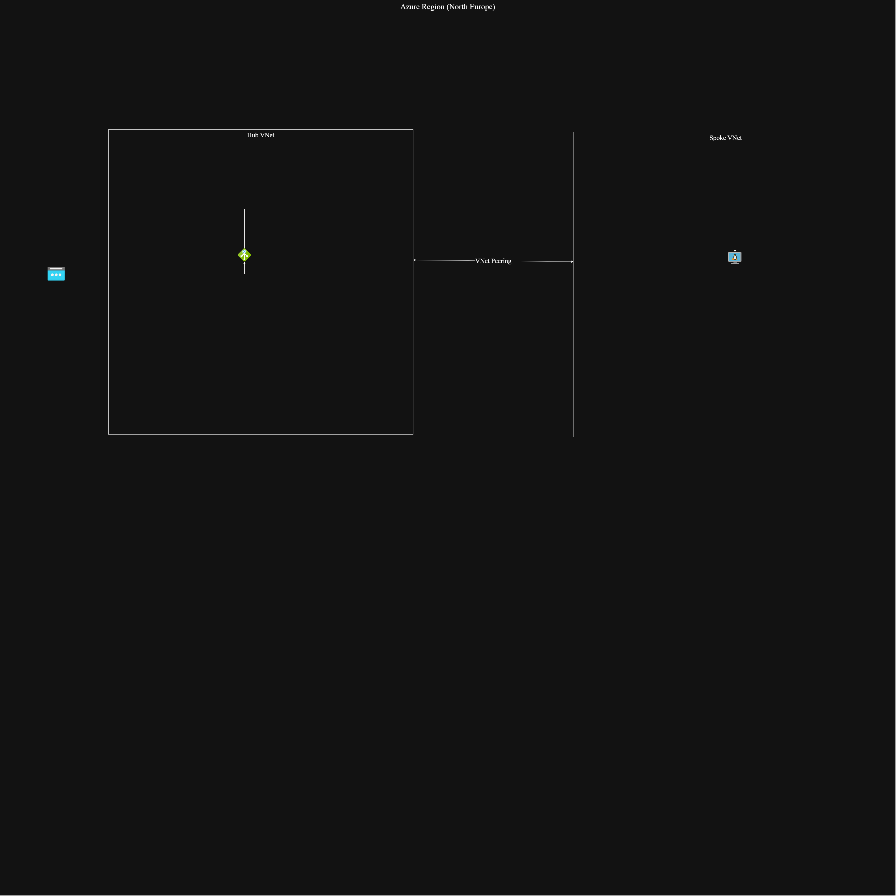
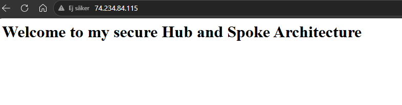

# Secure Hub-and-Spoke Network Architecture in Azure

This repository demonstrates the design and deployment of a secure Hub-and-Spoke network topology in Microsoft Azure using the Azure CLI. The objective of this project is to create an isolated network environment where backend resources are completely protected from the public internet, and all incoming traffic is routed and inspected through a central Application Gateway.

## Architecture & Technologies Used
* **Cloud Provider:** Microsoft Azure
* **Automation:** Azure CLI, Bash scripting
* **Networking:** Virtual Networks (VNet), VNet Peering, Application Gateway, Network Security Groups (NSG)
* **Compute:** Azure Virtual Machines (Ubuntu Linux)
* **Workarounds:** Python HTTP Server (used to simulate backend workloads in an entirely offline environment)

## Implementation Steps
The complete deployment script can be found in `scripts/deploy_hub_spoke.sh`. The workflow is as follows:
1. **Infrastructure Foundation:** Provisioned a Hub VNet (for central services) and a Spoke VNet (for workloads).
2. **Network Routing:** Established bi-directional VNet Peering to allow internal routing between the VNets.
3. **Isolated Compute:** Deployed an Ubuntu Linux VM in the Spoke VNet with no public IP address, ensuring it cannot be accessed directly from the internet.
4. **Security Configuration:** Opened port 80 on the backend VM's NSG.
5. **Backend Simulation:** Used Azure VM Run Command to inject and start a lightweight Python HTTP server on the isolated VM, bypassing the need for outbound internet access to download external packages.
6. **Frontend Gateway:** Deployed an Application Gateway in the Hub VNet with a public IP to act as the secure entry point, routing incoming web traffic securely to the private VM.

## Troubleshooting & Lessons Learned
During the deployment of this architecture, I encountered and resolved several real-world cloud infrastructure limitations:

* **vCPU Quota Limitations (`QuotaExceeded`):** 
  * *Issue:* The initial VM deployment in Sweden Central failed with a `QuotaExceeded` error, as the default VM size exceeded the allowed vCPU limit for the subscription.
  * *Resolution:* Analyzed the error and updated the CLI deployment script to request a smaller compute instance (`Standard_B1s`).

* **Regional Capacity Restrictions (`SkuNotAvailable`):**
  * *Issue:* The deployment was subsequently rejected with a `SkuNotAvailable` error, indicating a temporary physical hardware shortage for the B1s size in that specific region. 
  * *Resolution:* Migrated the foundational networking infrastructure to North Europe. After analyzing available SKUs using the Azure Portal, I adapted the deployment to use `Standard_D2als_v6`, which successfully provisioned.

* **API Version Requirements (`RulePriorityCannotBeEmpty`):**
  * *Issue:* The Application Gateway deployment failed because newer Azure API versions strictly require a priority definition for request routing rules.
  * *Resolution:* Modified the deployment script to explicitly include `--priority 100`, successfully adapting to updated infrastructure-as-code requirements.

* **Backend Connection Issues (`502 Bad Gateway`):**
  * *Issue:* The Application Gateway successfully received public traffic but returned a 502 error because the backend VM's Network Security Group blocked incoming HTTP requests, and the VM lacked an active web server.
  * *Resolution:* Opened port 80 on the NSG. Discovered that the VM lacked outbound internet access to run `apt-get install nginx`, validating the effectiveness of the network isolation. I bypassed this by using a pre-installed Python HTTP server via Azure Run Command to establish end-to-end connectivity.

## Proof of Concept
The final test confirms that public traffic hitting the Application Gateway's public IP is successfully routed into the isolated Spoke VNet, rendering the custom web page running on the private VM.

The final test confirms that public traffic hitting the Application Gateway's public IP is successfully routed into the isolated Spoke VNet, rendering the custom web page running on the private VM.

